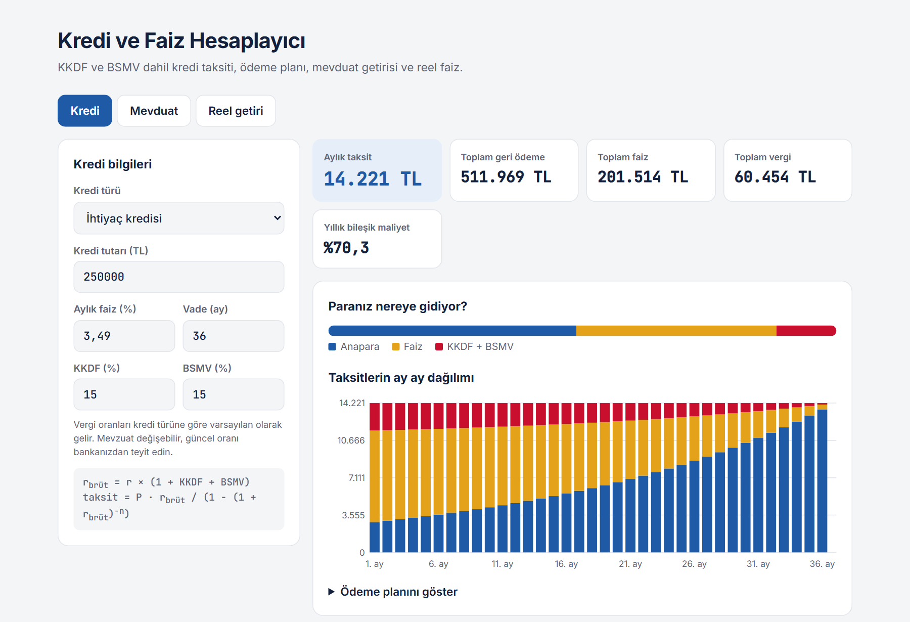

# 💳 Kredi ve Faiz Hesaplayıcı


Türkiye'deki bireysel krediler için **KKDF ve BSMV dahil** taksit ve ödeme planı, vadeli mevduat getirisi (stopaj dahil) ve **reel faiz** hesaplayıcı.

🔗 **Canlı demo:** https://mehmet-vural.github.io/kredi-faiz-hesaplayici/



---

## Özellikler

| Bölüm | Ne hesaplar? |
|---|---|
| **Kredi** | Aylık taksit, toplam geri ödeme, toplam faiz ve vergi, yıllık bileşik maliyet, ay ay ödeme planı |
| **Mevduat** | Vade sonu net faiz (stopaj sonrası), vade yenilendikçe bileşik büyüme, yıllık efektif net getiri |
| **Reel getiri** | Fisher denklemiyle enflasyondan arındırılmış getiri; "getiri eksi enflasyon" kısayolunun ne kadar yanılttığı |

## Matematik

### Eşit taksitli kredi (annüite)

Bankanın aylık faizi $r$ olsun. Bireysel kredilerde faize KKDF ve BSMV eklendiği için borçlunun ödediği gerçek aylık oran:

$$r_{brüt} = r \times (1 + \text{KKDF} + \text{BSMV})$$

$P$ anapara ve $n$ vade (ay) için eşit taksit:

$$T = P \cdot \frac{r_{brüt}}{1 - (1 + r_{brüt})^{-n}}$$

Bu formül, taksitlerin bugünkü değerleri toplamının anaparaya eşit olmasından gelir:

$$P = \sum_{k=1}^{n} \frac{T}{(1 + r_{brüt})^k}$$

Her ay kalan borcun faizi ödenir, taksitin geri kalanı anaparayı azaltır. Bu yüzden ilk taksitlerin çoğu faizdir, son taksitlerin çoğu anaparadır.

### Yıllık bileşik maliyet

$$\text{Yıllık maliyet} = (1 + r_{brüt})^{12} - 1$$

Örneğin aylık %3,49 faizli ihtiyaç kredisinin (KKDF %15 + BSMV %15) yıllık bileşik maliyeti **%70,3**'tür.

### Vadeli mevduat

$$\text{Net faiz} = P \times i \times \frac{gün}{365} \times (1 - \text{stopaj})$$

### Reel faiz (Fisher denklemi)

$$1 + r_{reel} = \frac{1 + i}{1 + \pi}$$

%45 nominal getiri ve %33 enflasyonda reel getiri %12 değil, **%9,0**'dır. Yüksek enflasyonda "getiri eksi enflasyon" kısayolu ciddi şekilde yanıltır.

## Kullanım

**Tarayıcıda:** [Canlı demoyu](https://mehmet-vural.github.io/kredi-faiz-hesaplayici/) açın ya da `index.html` dosyasını indirip çift tıklayın. Kurulum gerekmez.

**Python'da:**

```python
from kredi.hesap import VERGILER, aylik_taksit, odeme_plani, reel_faiz

aylik_taksit(250_000, 0.0349, 36, **VERGILER["ihtiyac"])   # 14221.36
plan = odeme_plani(250_000, 0.0349, 36, **VERGILER["ihtiyac"])
plan[0]   # Taksit(ay=1, taksit=14221.36, anapara=2878.86, faiz=8725.0, kkdf=1308.75, bsmv=1308.75, ...)
reel_faiz(0.45, 0.33)                                      # 0.0902
```

**Testler:**

```bash
pip install pytest
pytest
```

## Proje yapısı

```
├── index.html          # Tarayıcıda çalışan hesaplayıcı (bağımlılık yok)
├── kredi/hesap.py      # Hesaplamaların Python karşılığı
└── tests/              # pytest testleri
```

## Notlar

- KKDF, BSMV ve stopaj oranları mevzuatla değişebilir. Hesaplayıcıda hepsi düzenlenebilir; varsayılanlar yalnızca başlangıç değeridir.
- Bankalar dosya masrafı, sigorta gibi ek kalemler de alabilir; bunlar hesaba dahil değildir.
- Enflasyonun 20 yıllık seyri için: [enflasyon-doviz-analizi](https://github.com/mehmet-vural/enflasyon-doviz-analizi)

> ⚠️ Eğitim amaçlıdır, finansal tavsiye değildir.

---

**Mehmet Vural** · Matematik Öğretmeni · Geliştirici · Finans · [LinkedIn](https://www.linkedin.com/in/mehmetvrl/)
